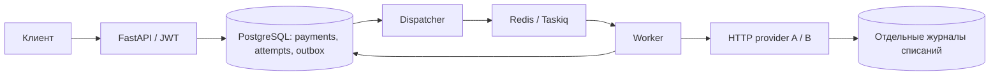

# Cascade Payments

Демонстрационный сервис каскадирования платежей: сначала обращается к провайдеру A,
а после разрешённого подтверждённого отказа — к B. Если ответ потерян, сначала
выясняет результат у прежнего провайдера, чтобы избежать повторного списания.

**A и B — собственные HTTP mock-провайдеры с отдельными базами и журналами
списаний. Внешний sandbox не подключён, реальные деньги не используются.**

Реализованы JWT, идемпотентность запросов, фоновая обработка, сверка неизвестного
результата и восстановление после сбоев. Стек: Python 3.13, FastAPI, PostgreSQL,
Redis/Taskiq, SQLAlchemy/asyncpg, Alembic, Docker Compose.

## Запуск

Понадобятся Docker с Compose v2, Python 3.13 на компьютере и свободные порты
5432, 6379, 8000, 8001, 8002. Команды ниже рассчитаны на Unix shell;
Windows/WSL пока не проверены. Poetry для запуска через Docker не нужен.

Из корня клонированного репозитория:

```sh
# Создать локальные настройки и случайные секреты.
python3.13 scripts/configure_local.py

# Проверить конфигурацию и собрать образ приложения.
docker compose config -q
docker compose build

# Запустить хранилища и применить миграции трёх отдельных БД.
docker compose up -d --wait postgres redis
docker compose run --rm migrate
docker compose run --rm migrate-mock-a
docker compose run --rm migrate-mock-b

# Запустить API, фоновые процессы и провайдеров.
docker compose up -d --wait api worker dispatcher mock-a mock-b

# Проверить готовность API.
curl --fail http://localhost:8000/health/ready
docker compose ps
```

Ожидается `{"status":"ok"}` и семь сервисов со статусом healthy.
API доступен на `http://localhost:8000`, OpenAPI — на `/docs`.

Генератор создаёт `.env` один раз и отказывается перезаписывать существующий файл.
Не отправляйте `.env` вместе с проектом: получатель создаёт свои секреты.
Миграции можно запускать повторно. Если порт 8000 занят, смотрите
[настройку портов](docs/operations.md#если-порт-api-занят).

## Демонстрация

После запуска выполняйте команды по очереди. Каждая создаёт новый тестовый платёж,
ждёт результата и проверяет журнал списаний провайдера. Ошибка проверки даёт
ненулевой код завершения.

```sh
docker compose --profile demo run --rm demo first-success
docker compose --profile demo run --rm demo cascade-success
docker compose --profile demo run --rm demo all-declined
docker compose --profile demo run --rm demo lost-response
docker compose --profile demo run --rm demo duplicate-delivery
```

В выводе `ledger_counts` — число списаний у `[A, B]`, а `attempts` — история попыток.
`amount_minor=123` означает 1,23 USD.

| Сценарий | Ожидаемый результат |
|---|---|
| `first-success` | A успешно списал; B не вызван; списания `[1, 0]` |
| `cascade-success` | A отказал, B успешно списал; списания `[0, 1]` |
| `all-declined` | Оба отказали; платёж `failed`; списания `[0, 0]` |
| `lost-response` | A списал, но ответ потерян; `unknown` → сверка → `succeeded`; B не вызван |
| `duplicate-delivery` | 10 конкурентных POST и повторные задачи; один платёж и одно списание |

Дополнительная демонстрация D6 проверяет падения процессов и восстановление.
Она требует локальных зависимостей и очищает Redis выбранного demo-проекта:
[инструкция и ограничения](docs/operations.md#аварийные-проверки-d6).

## Как это работает



1. API сохраняет платёж и запись о будущей задаче (**outbox**) одной транзакцией.
   Возвращает `202 Accepted`: запрос принят, обработка ещё не завершена.
2. Dispatcher публикует задачу в Redis. Worker сохраняет попытку и право её
   обработки, затем вызывает провайдера по HTTP вне SQL-транзакции.
3. Worker сохраняет результат и при разрешённом отказе A создаёт попытку B.
   Клиент читает состояние и историю через `GET /payments/{id}`.
4. При потере ответа сохраняется `unknown`. Сверка ищет операцию по заранее
   сохранённому ключу; таймаут сам по себе не разрешает переход к B.
5. После сбоя dispatcher восстанавливает незавершённую работу из PostgreSQL,
   в том числе после потери Redis.

Клиентский `Idempotency-Key` защищает от повторного создания платежа, ключ
попытки у провайдера — от повторного списания. Доставка задач допускает дубли;
exactly-once доставка не заявляется. Подробности — в [решениях](docs/decisions.md).

## API

Для POST/GET требуется Bearer JWT. Merchant определяется из токена.

| Запрос | Назначение |
|---|---|
| `POST /payments` | Создать платёж с `Idempotency-Key`; ответ `202` с id и status |
| `GET /payments/{id}` | Получить свой платёж и историю попыток |
| `GET /health/live` | Проверить, отвечает ли процесс API |
| `GET /health/ready` | Проверить доступ API к PostgreSQL и Redis |

Тело POST: `{"amount_minor":123,"currency":"USD","payment_method_ref":"demo-ref"}`.
Повтор ключа с теми же данными возвращает прежний платёж; с другими — `409`.
Чужой или неизвестный платёж возвращает `404`, неверный JWT — `401`,
невалидные входные данные — `422`.

[Ручной POST/GET и выпуск demo-токена](docs/operations.md#ручной-запрос-к-api).
Точные правила валидации — в [контракте API](docs/decisions.md#публичный-api-и-идемпотентность).

## Проверки

После миграций и запуска всех сервисов выполните полный набор из Docker:

```sh
docker compose run --rm -e RUN_INTEGRATION=1 -e API_URL=http://api:8000 api pytest -q
```

В проверенной версии — **299 тестов без пропусков**. Они используют PostgreSQL,
Redis, HTTP и независимые журналы списаний mock. Даты, окружение и ограничения
приведены в [отчёте проверок](docs/verification.md).

[Локальная установка, Ruff и дополнительные проверки](docs/operations.md#локальная-разработка).
Без `RUN_INTEGRATION=1` интеграционные тесты пропускаются.

## Остановка и повторный запуск

```sh
docker compose stop
docker compose up -d --wait api worker dispatcher mock-a mock-b
```

Данные PostgreSQL сохраняются. Для обычного повторного запуска не удаляйте volume.
Полный сброс описан отдельно в [инструкции обслуживания](docs/operations.md#полный-сброс-demo).

## Ограничения

- Только USD, полное одноэтапное списание и фиксированный маршрут A → B.
- Таймаут, `pending`, неожиданный HTTP-ответ и обычный lookup `not_found`
  не доказывают отказ и не разрешают B.
- Сверка ограничена пятью проверками и 60 секундами. Если исход не выяснен,
  остаётся `unknown` с признаком ручного разбора; endpoint ручного разрешения нет.
- Защита от повторного списания зависит от долговечной идемпотентности и корректного
  lookup провайдера. Потеря PostgreSQL volume не покрывается.
- Нет интеграции с реальным PSP, возвратов, 3DS, webhooks, UI и S3.
  JWT не включает полноценный login, refresh, revocation или ротацию.
- Production-ready, PCI-соответствие и нагрузочный SLA не заявляются.

## Документация

| Документ | Когда читать |
|---|---|
| [Запуск и обслуживание](docs/operations.md) | Нужны ручной запрос, другой порт, локальная разработка или аварийная проверка |
| [Архитектура и контракты](docs/decisions.md) | Нужно разобраться в состояниях, транзакциях и восстановлении |
| [Контракт провайдеров](docs/provider-contract.md) | Нужно понять HTTP-интеграцию, mock и требования к реальному адаптеру |
| [Матрица приёмки](docs/acceptance.md) | Нужно найти тест конкретной гарантии |
| [Результаты проверок](docs/verification.md) | Нужно узнать, что фактически запускалось и с каким результатом |
| [Актуальные проблемы](docs/known-issues.md) | Нужно проверить известные нерешённые замечания |
