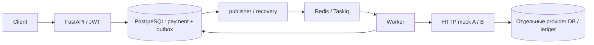

# Контракты и решения MVP

Статус: контракты приняты; окружение, health и базовая миграция реализованы и проверены — [проверки окружения](verification.md). Success через A и последовательный каскад после подтверждённых разрешённых отказов реализованы; проверки и ограничения — в verification.md. Сверка и DB recovery ещё не реализованы. Нормативный контракт провайдеров: [provider-contract.md](provider-contract.md), критерии будущей проверки: [acceptance.md](acceptance.md).

## Объём и архитектура

Одноэтапное полное списание в USD, фиксированный последовательный маршрут A → B. Платёж — намерение merchant списать сумму; попытка — одна операция у одного провайдера с неизменным ключом. Snapshot маршрута `["A","B"]` сохраняется при создании платежа и не меняется вместе с конфигурацией. Тестовый payment_method_ref переносим только между mock. PAN/CVV не принимаются.

Один модуль: domain содержит Payment (aggregate root), PaymentAttempt и правила переходов; application — create/get/process/reconcile и порты repository/UoW/provider; infrastructure — SQLAlchemy/asyncpg, HTTP, Taskiq и dispatcher; presentation — API DTO и JWT. Зависимости направлены к domain/application. Domain не импортирует FastAPI, SQLAlchemy или HTTP. UoW объединяет изменения одной транзакцией.

Domain entities — отдельные Pydantic v2 BaseModel, `frozen=True`, `extra=forbid`, идентичность по UUID, явные методы переходов. DTO и ORM отдельны, преобразование явное. Новый снимок после проверки перехода создаётся с полной валидацией; `model_construct` и `model_copy(update=...)` для обхода правил запрещены: эти обходные пути не проверяют обновлённые данные ([Pydantic models](https://docs.pydantic.dev/latest/concepts/models/)). Pydantic в domain — осознанное исключение для стека задания. Strict-проверки задаются явно: библиотека допускает преобразования типов по умолчанию ([Pydantic](https://docs.pydantic.dev/latest/concepts/strict_mode/)).

Выбранный стек реализации: Python 3.13, FastAPI, PostgreSQL, Redis/Taskiq, SQLAlchemy async/asyncpg, Alembic, httpx, Pydantic v2/pydantic-settings, PyJWT, Poetry/lock, Docker Compose, pytest, Ruff lint/format. API запускается двумя Gunicorn worker с отдельным `uvicorn-worker`; встроенный `uvicorn.workers` устарел ([Uvicorn](https://uvicorn.dev/deployment/#gunicorn)). DB pool создаётся внутри процесса, preload не используется. Worker и dispatcher — отдельные процессы той же кодовой базы; фоновые циклы не запускаются в ASGI startup каждого worker. Точные версии зависимостей и совместимость фиксируются при bootstrap, здесь установка не выполнялась.

За пределами MVP: реальный sandbox/деньги, UI, webhooks, подписки, возвраты, capture, FX, 3DS, динамический роутинг, circuit breaker, микросервисы, мониторинговая платформа. Нет обещания production-ready, exactly-once доставки или RPS/100 000 пользователей. S3/aioboto3 не включены: нет файлового сценария; работающая выгрузка отчёта потребовала бы нового API и проверок. Реальный sandbox потребовал бы внешних credentials и отдельной проверки идемпотентности/lookup; устойчивые mock позволяют воспроизводить нужные сбои.

## Публичный API и идемпотентность

`POST /payments`, `Content-Type: application/json`, `Authorization: Bearer …`, один обязательный `Idempotency-Key` — непустая строка до 128 символов. Ключ — видимые ASCII-символы 0x21..0x7E (без пробелов/управляющих), регистр значим; не обрезать и не менять. Scope: `(merchant_id, idempotency_key)`, хранение весь срок данных платежа. Отсутствующий/пустой/слишком длинный или дублированный header — 422. Merchant не принимается в теле.

Тело содержит ровно `amount_minor`, `currency`, `payment_method_ref`. Currency — строгая строка из трёх ASCII-букв, приводится к верхнему регистру; принимается только USD (например, usd → USD), пробелы не удаляются. Лишние поля и null запрещены. Amount_minor — строго JSON integer, 1..9223372036854775807; bool, float (включая 1.0/1e0) и числовые строки запрещены. Хранение — BIGINT с CHECK >0, без преобразования через float; верхняя граница соответствует [PostgreSQL BIGINT](https://www.postgresql.org/docs/current/datatype-numeric.html). Payment_method_ref — строгая Unicode-строка 1..255 кодовых точек, без Unicode whitespace (str.isspace), управляющих Cc, форматирующих Cf и surrogate Cs; без trim, casefold или Unicode-нормализации. Остальные символы сохраняются буквально. Пустой/длинный ref, неподходящий тип или лишнее поле →422 до записи БД. Это технический предел MVP, не финансовый бизнес-лимит.

Canonical JSON строится только из трёх проверенных нормализованных полей: ключи сортируются, separators=(',', ':'), ensure_ascii=False, UTF-8, без BOM и завершающего newline. SHA-256 в lowercase hex — request_hash. Merchant/key вне hash; ref не нормализуется. Например: `{"amount_minor":100,"currency":"USD","payment_method_ref":"demo-ref"}`. В БД сохраняются и данные, и hash; повтор сравнивается с исходными нормализованными полями, а не только с hash.

В одной транзакции создаются payment(pending) и outbox; после commit — 202 `{"id":"<UUID>","status":"pending"}` и `Location: /payments/<UUID>`. Повтор равных данных всегда 202 с тем же id и текущим status, включая terminal. Другие данные — 409 `{"error":{"code":"idempotency_conflict"}}`. Конкурентная вставка использует `INSERT ON CONFLICT DO NOTHING RETURNING`, затем отдельный SELECT победителя при READ COMMITTED. Уникальный конфликт в этом SQL не является исключением и не переводит транзакцию в aborted state; следующий statement получает новый snapshot. Сравниваются hash **и** нормализованные поля. Для настоящей ошибки INSERT требуется rollback/savepoint; продолжать чтение из aborted transaction нельзя.
Семантика подтверждена [PostgreSQL 17: isolation](https://www.postgresql.org/docs/17/transaction-iso.html#XACT-READ-COMMITTED), [INSERT](https://www.postgresql.org/docs/17/sql-insert.html#SQL-ON-CONFLICT) и [SQLAlchemy 2.0](https://docs.sqlalchemy.org/en/20/dialects/postgresql.html#insert-on-conflict-upsert). В проекте SQLAlchemy 2.0.57/asyncpg 0.32.0, фактический уровень изоляции проверяет integration-тест. Изменение уровня изоляции требует пересмотра протокола. Удаления платежей/ключей и TTL в MVP нет. Недоступность Redis после commit не отменяет платёж. Недоступность БД — 503, клиент повторяет исходный key; потеря ответа на commit не доказывает отсутствие платежа.

`GET /payments/{id}` — 200 с `id, status, amount_minor, currency, created_at, updated_at, manual_review_required, attempts`. UUID и время передаются строками, время UTC RFC3339. Attempts упорядочены по sequence и содержат только `id, sequence, provider, status, external_id|null, error_code|null, check_count, manual_review_required, created_at, updated_at`. Marker платежа вычисляется по активной попытке. Не выдавать method_ref, provider key, request_hash, lease/version, credentials или сырой ответ провайдера. Неизвестный/чужой UUID — одинаковый 404 `{"error":{"code":"payment_not_found"}}`; некорректный UUID — 422. Прочие validation errors имеют код `validation_error` и безопасный список имён полей, без исходных значений.

JWT: PyJWT, разрешён только HS256, algorithms задаётся сервером. Обязательны sub/exp/iat/iss/aud; issuer=payments-demo, audience=payments-api, sub — UUID одного из двух merchant из конфигурации. Проверяются подпись, issuer/audience, exp, iat (не в будущем), exp>iat и TTL не более 900 с; leeway=0. exp/iat — целые NumericDate без bool. Поддержка обязательных claims и проверки сроков описана в [PyJWT](https://pyjwt.readthedocs.io/en/stable/usage.html). Отсутствующий/невалидный токен — 401 с `WWW-Authenticate: Bearer` и кодом `unauthorized`. Старый API key не поддерживается. Локальный CLI выдаёт demo-токены с TTL 15 минут; публичного login, refresh, revocation, ротации и IdP нет. Секрет — минимум 32 случайных байта через env; рабочие секреты и JWT не коммитятся и не логируются.

Логи — структурированные payment_id/attempt_id/provider/duration/result; без Authorization/JWT, signing secret, service credential, method_ref и сырых тел.

Health: `GET /health/live` — 200 `{"status":"ok"}` при живом процессе. Ready проверяет PostgreSQL и Redis: 200 ok / 503 `{"status":"unavailable"}`, без деталей подключения; доступность mock для ready API не требуется.

## Модель хранения

Все timestamps — PostgreSQL timestamptz, UTC; время владения сравнивается по часам БД после получения lock (не по времени начала ожидавшей транзакции). UUID генерируются приложением. Поля NOT NULL, кроме явно nullable.

| Таблица | Поля и ограничения |
|---|---|
| payments | id UUID PK; merchant_id UUID; amount_minor BIGINT CHECK >0; currency varchar(3), CHECK USD; payment_method_ref varchar(255) CHECK length 1..255; status; idempotency_key varchar(128); request_hash char(64); routing_snapshot JSONB; created_at/updated_at; UNIQUE(merchant_id,idempotency_key) |
| payment_attempts | id UUID PK; payment_id UUID FK; sequence smallint (1 или 2); provider (A/B); provider_idempotency_key UUID (=id); external_id UUID nullable; status; error_code varchar(64) nullable; created_at/updated_at; UNIQUE(payment_id,sequence), UNIQUE(provider,provider_idempotency_key) |
| Координация попытки | lease_until nullable; claim_version BIGINT default 0 CHECK >=0; check_count smallint default 0 CHECK 0..5; reconciliation_deadline nullable; manual_review_required boolean default false; safe_retry_until; next_check_at nullable |
| outbox | id UUID PK; event_type (`process_payment`/`reconcile_payment`); payment_id UUID FK; payload JSONB (`{"payment_id":"<UUID>"}`); published_at nullable; created_at/updated_at |

Индексы: attempts(payment_id), outbox(payment_id), неопубликованный outbox(created_at) WHERE published_at IS NULL, due attempts(next_check_at) без manual marker, in_flight(lease_until), payments(status,updated_at). CHECK для допустимых статусов и диапазонов; единственная нетерминальная попытка на payment защищается также partial UNIQUE(payment_id) WHERE status IN ('created','in_flight','unknown'). Создание попыток и все переходы — под lock payment, затем attempt в этом порядке; никогда не удерживать транзакцию на сетевом HTTP.

Payload попытки восстанавливается из неизменных amount/currency/ref платежа; provider/key/sequence не меняются. safe_retry_until = created_at попытки +24 ч, не продлевается. Состояние платежа/история/ключи не очищаются в MVP. Независимая очистка mock запрещена.

## Состояния и разрешение каскада

Платёж: pending → processing при создании A; processing → unknown при неоднозначности. Unknown остаётся unknown во время lookup и повторного charge этой же операции. Из unknown возможны succeeded, failed или processing при подтверждённом разрешённом отказе и создании B. Succeeded/failed терминальны.

Попытка: created → in_flight → succeeded/declined/unknown. Unknown → succeeded/declined/unknown; expired in_flight сначала становится unknown. Succeeded/declined терминальны. Manual marker не новый статус и не доказательство отказа.

| Нормализованный результат charge или lookup | Attempt / payment / действие |
|---|---|
| succeeded | succeeded / succeeded; остановиться |
| declined_retryable + issuer_unavailable | declined; атомарно B created + payment processing + outbox; если маршрут исчерпан — failed |
| declined_terminal + invalid_payment_method | declined / failed, B не создавать |
| not_charged_final | declined с error_code=not_charged_final; B либо failed при исчерпании, только по устойчивой записи провайдера |
| pending | unknown / unknown; сверка |
| timeout, disconnect, HTTP 5xx, неожиданный 4xx, malformed/неизвестный code или status, несовпадение key/payload | unknown / unknown; сверка |
| lookup not_found | unknown / unknown; допустим только ограниченный повтор прежней операции, B запрещён |

При разрешённом отказе отказ A и создание B/outbox сохраняются одной транзакцией, поэтому crash между ними не теряет каскад. Каждая новая попытка использует новый UUID, но повтор существующей — всегда прежний. Обычный HTTP 4xx не является бизнес-отказом. Неоднозначность и исчерпание времени никогда не дают failed.

## Владение, сверка и восстановление

Базовые уже принятые тайминги: lease 10 с; полный HTTP-вызов ограничен 2 с; recovery scan каждые 2 с; первая сверка через 1 с, далее задержки 2/4/8/16 с; максимум 5 проверок и deadline 60 с от первого unknown. HTTP выполняется вне DB-транзакции; перед отправкой claim закоммичен. Под lock created → in_flight, lease_until=now+10 с, claim_version+=1. Активный lease делает дубли no-op. Ответ требует совпадения версии и ожидаемого нетерминального состояния; terminal не перезаписывается. Ответ также требует lease_until > now БД: даже ещё не сменившийся version не даёт права сохранить ответ после истечения lease. Lease не продлевается в рамках HTTP-цикла.

### Точная последовательность сверки

1. Под lock payment → attempt: terminal/manual → no-op; затем **действующий lease → no-op до проверки лимитов**. Recovery не отбирает пятую проверку у живого владельца.
2. Expired in_flight переводится в unknown, payment unknown; прежний version инвалидируется. При первом unknown установить deadline=now+60с и next_check_at=now+1с, check_count оставить прежним. Для обычного ответа unknown эти поля задаются в транзакции сохранения ответа. Deadline больше не сдвигается.
3. У unknown без действующего lease проверить check_count>=5 или now>=deadline **раньше due-проверки**. Если да: claim_version+=1, lease_until=NULL, marker=true, next_check_at=NULL; commit. Без HTTP, без B, payment остаётся unknown. Recovery выбирает и unknown с истёкшим lease и исчерпанным бюджетом, даже если due-время ещё не наступило.
4. Если бюджет есть, но now<next_check_at — no-op. Иначе atomically claim_version+=1, lease_until=now+10с, check_count+=1; commit **до lookup**. Unknown не переводить в in_flight; lease показывает, что сверка выполняется. Не обнулять next_check_at до результата, чтобы crash оставался виден recovery.
5. Один цикл = один lookup и максимум один charge по обычному not_found. Pending/ошибка lookup не вызывает charge. Перед повторным charge проверить сохранённый version, lease и now<safe_retry_until в короткой транзакции, закрыть её, затем HTTP; на точной границе окна повтор запрещён. Не выполнять цикл повторно на уровне HTTP-клиента. Каждый HTTP ограничен общим wall-clock timeout=2с (отдельные socket timeouts недостаточны). Два вызова должны укладываться в lease 10с; если lease кончился — ответ не сохранять.
6. Результат сохранять под lock только при совпадении version, status unknown (либо in_flight для исходного charge), marker=false и **lease_until>now**. Check_count=5 и наступивший deadline не мешают сохранить финал ещё действующему владельцу: они ограничивают старт новых циклов. При success/decline применить таблицу, очистить lease/next_check_at; существующие check_count/deadline сохранить в истории.
7. При результате unknown очистить lease. Если check_count>=5 или now>=deadline — marker=true, next_check_at=NULL. Иначе next_check_at=min(now+delay,deadline), где после проверки 1/2/3/4 delay=2/4/8/16с. Изменение unknown и outbox для дальнейшей обработки сохранять вместе. Задачи проверяют due в БД, даже если уже доставлены.

Падение после commit check_count=5, до HTTP или ответа: слот потрачен; при действующем lease дубли no-op, после его истечения recovery выполняет пункт 3 без шестого lookup. Поздний ответ отвергается. Если пятый владелец успел записать success до конца lease, recovery видит terminal и ничего не меняет. Если результат остаётся pending/not_found/ошибкой, владелец сам включает manual. Консервативная потеря слота допустима, бесконечное восстановление слотов — нет.

На границе lease равенство означает истечение; на deadline равенство запрещает новый цикл. HTTP не прерывается только из-за deadline, если lease ещё действителен. Crash после lookup not_found до charge не разрешает recovery повторить тот же слот: следующий claim расходует новый, если он остался.

Settings должны проверять положительность интервалов, HTTP timeout*2 < lease, recovery interval < lease, конечный reconciliation budget/deadline и safe window <=24ч; demo defaults выше, тестовые часы/интервалы допустимы при тех же отношениях. safe_retry_until относится и к первой отправке: created, дожившая без отправки до конца окна, становится unknown и сверяется, новый key не выдаётся.

### Брокер, ACK и повторная доставка

Выбран `taskiq_redis.RedisStreamBroker`: одна stream `payments`, consumer group `payments-workers`, consumer_name уникален на процесс, consumer_id=`0-0`, mkstream=true, maxlen=None (не обрезать неподтверждённые записи). Параметры: xread_block=2000мс, idle_timeout=10000мс, xread_count=100, unacknowledged_batch_size=100, unacknowledged_lock_timeout=5с. Redis должен поддерживать XAUTOCLAIM (>=6.2). Конкретные версии всего стека фиксируются в lock при bootstrap.

В проверенном [исходнике taskiq-redis 1.2.4](https://raw.githubusercontent.com/taskiq-python/taskiq-redis/1.2.4/taskiq_redis/redis_broker.py) возврат pending расположен после чтения новых записей; пустое чтение пропускает его. Поэтому инфраструктурный адаптер поверх RedisStreamBroker обязан выполнять независимый reclaim каждые 2с, даже без новых публикаций: XAUTOCLAIM с idle>=10с, batch=100, продолжение с возвращённого cursor, доставка исходных байтов как AckableMessage с ACK исходного stream ID. Не переиздавать reclaimed сообщение как новую финансовую команду. Reclaim может дублировать ещё работающий handler — DB lease/version остаются обязательны. Это требование реализации, не уже проверенная возможность установленного пакета. [XAUTOCLAIM](https://redis.io/docs/latest/commands/xautoclaim/) переносит владение pending-сообщением; [XACK](https://redis.io/docs/latest/commands/xack/) снимает его из pending.

Для платёжных задач выбрать `ack_type=manual`; `Context.ack()` вызывается после commit результата либо после проверенного no-op (terminal/manual/active lease/not due). Исключение до commit не подтверждать. Если unknown сохранён и дальнейшее действие записано в БД — ACK допустим. ACK не ждёт финансового успеха. Режимы ACK описаны в [Taskiq CLI](https://taskiq-python.github.io/guide/cli.html#acknowledgements); `when_saved` относится к result backend, а не PostgreSQL приложения. Result backend не источник платёжного результата.

At-least-once на уровне транспорта условно: сохранены stream/group/pending, работают consumer и periodic reclaim, нет trim/удаления. Убийство worker до ACK → повтор исходного сообщения; после commit до ACK → безопасный дубль. Поддержка ACK Stream и отсутствие ACK у PubSub/ListQueue указаны в [документации taskiq-redis](https://github.com/taskiq-python/taskiq-redis#brokers). Потеря/flush/recreate Redis теряет эти гарантии брокера. После восстановления соединения пересоздаётся consumer group с 0-0; dispatcher по PostgreSQL повторно публикует незавершённую работу, даже при published_at!=NULL. Утраченные задачи terminal/manual не восстанавливаются, поскольку работы для них нет. Пока Redis недоступен, DB сохраняет намерение, но фонового прогресса не обещаем. Exactly-once доставки нет.

Publisher публикует outbox, затем записывает published_at. Сбой между этими действиями даёт дубль. Ошибка/таймаут публикации оставляет запись неопубликованной. Один publisher, ограниченный batch и сетевой timeout. Redis хранит только задания с IDs, а не финансовую истину или единственное расписание.

Recovery сканирует pending без попыток, created, expired in_flight и due unknown. Published_at не исключает восстановление. Processing без активной попытки восстанавливается по истории под lock: нельзя выбирать B только из-за возраста платежа. Все изменения с новыми событиями — атомарны. Ни check_count, ни deadline, ни safe_retry_until, ни manual marker не сбрасываются. Терминальные и manual записи не вызывают HTTP. При недоступности PostgreSQL финансовая обработка останавливается; утрата его данных вне гарантии.

Manual review: сохранить unknown, marker=true, next_check_at=NULL; автоматика не возобновляет. Оператор собирает payment/attempt/provider key из защищённого хранилища, сопоставляет lookup и provider ledger; не создаёт новый платёж с новым ключом и не меняет статус SQL вслепую. Финансового endpoint ручного разрешения нет.

## Границы гарантий

Защита от повторного списания зависит от долговечной идемпотентности, канонического lookup и невозможности позднего списания после отказа у провайдера. Lease/version защищают локальное состояние, но не отменяют уже отправленный внешний запрос. Mock хранят ключи весь срок данных, безопасное окно отправки ограничено 24 ч; после него только lookup в оставшемся бюджете или ручной разбор. Недоступность зависимостей не имеет обещанного SLA. Реальные платёжные токены не считаются переносимыми между провайдерами.
